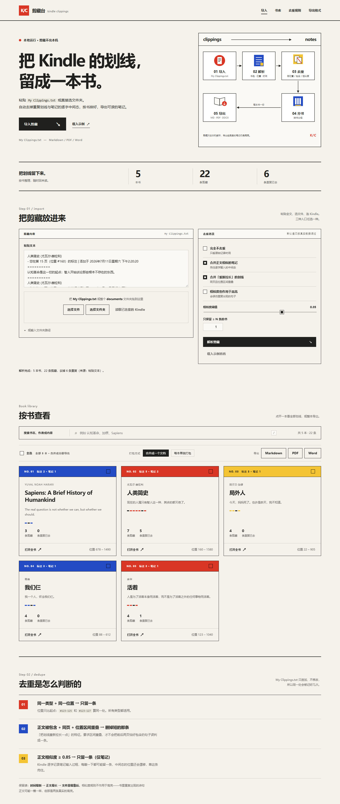

# 剪藏台 · kindle clippings

把 Kindle 的 `My Clippings.txt` 变成一本能读的书：**自动去重 → 按书分组 → 导出 Markdown / PDF / Word**。

界面参考 [blog.simona.plus/lecture-to-notes](https://blog.simona.plus/lecture-to-notes/) 的 Bauhaus 风格自己写的一套，所有解析都在本机完成，剪藏不会离开这台电脑。



## 怎么打开

双击项目里的 **`启动剪藏台.cmd`**，它会起一个本地服务并打开浏览器（默认 <http://127.0.0.1:8765>）。

命令行也行：

```bat
cd /d D:\ai\kindle-web
python -m app.server              :: 自动开浏览器
python -m app.server --no-open    :: 不开浏览器
python -m app.server --port 9000  :: 换端口（被占用时会自动 +1 重试）
```

关掉那个黑窗口就是退出。

### 依赖

| 用途 | 需要的东西 | 缺了会怎样 |
|---|---|---|
| 解析 / Markdown / 服务 | Python 3.9+（只用标准库） | 起不来 |
| Word 导出 | `pip install python-docx` | 点 Word 会提示装包 |
| PDF 导出 | 本机装了 Edge 或 Chrome | 点 PDF 会提示找不到浏览器 |

去重规则本身来自 `D:\我的读书库\_tools\kindle_clippings.py`（那个双击导出的老脚本），
网页版**直接 import 同一份代码**，所以两边结果永远一致；找不到时会退回本项目 `app/vendor/` 里的副本。

## 三种导入方式

1. **粘贴**：把 `My Clippings.txt` 的内容贴进左侧文本框，点「解析剪藏」。
2. **选文件 / 选文件夹**：`选择文件` 可多选 `.txt`；`选择文件夹` 会递归找出里面所有 `.txt`。
3. **直连 Kindle**：Kindle 用 USB 插上电脑后点「读取已连接的 Kindle」，自动找 `*/documents/My Clippings.txt`。
   也可以用文本框下面的「或输入文件夹路径」直接填 `D:\documents` 这种路径，让**服务端**去读。

> 浏览器拿不到真实路径，也读不了任意磁盘目录，所以「输入路径」这条是交给本机服务读的。
> 只想用浏览器读文件时，用前两种方式即可。

## 去重是怎么判断的

`My Clippings.txt` 是只追加的文件，重划一次、笔记逐字输入一次，都会多出一条。三条规则：

| # | 规则 | 范围 |
|---|---|---|
| 01 | 同类型 + 同位置 → 只留一条 | 全部 |
| 02 | 正文被包含 + 同页 + 位置区间重叠 → 删短的那条 | 全部 |
| 03 | 正文 bigram 相似度 ≥ 0.85 → 只留一条 | **只有笔记** |

保留优先级：时间最新 → 正文更长 → 文件里更靠后。右边「去重选项」里的开关对应老脚本的命令行参数：

| 开关 | 等价参数 | 说明 |
|---|---|---|
| 完全不去重 | `--keep-all` | 只按书分组，保留原始记录顺序 |
| 合并正文相似的笔记 | `--no-fuzzy` 的反面 | 关掉后只按位置/包含关系去重 |
| 合并「重新拉长」的划线 | `--no-containment` 的反面 | 关掉后同页被包含的短划线不再合并 |
| 相似度也作用于高亮 | `--fuzzy-all` | 默认只对笔记用相似度（高亮重复多是真高亮） |
| 相似度阈值 | `--similarity` | 默认 0.85，调高更严格 |
| 只保留 ≥ N 条的书 | — | 过滤掉只有一两条的书 |

## 导出

解析完在「按书查看」里，可以按三种范围导出：

| 范围 | 怎么选 | 得到什么 |
|---|---|---|
| 单本 | 点进卡片，用「导出这本」 | 一个 `书名_笔记.ext` |
| 多本 | 在书卡右上角勾选（或点「全选」），再选打包方式 | 见下面两行 |
| 全部 | 勾「全选」 | 同上 |

多本时的「打包方式」有两个：

| 打包方式 | Markdown | PDF | Word |
|---|---|---|---|
| 合并成一个文档 | `读书笔记合集_YYYY-MM-DD导出.md` | `读书笔记合集_YYYY-MM-DD导出.pdf` | `读书笔记合集_YYYY-MM-DD导出.docx` |
| 每本单独打包 | `读书笔记合集_YYYY-MM-DD导出.zip` | 同名 `.zip` | 同名 `.zip` |

- **命名规则**：单本是 `书名_笔记.md`（不带书名号），合集的日期是导出当天。
- **合并文档带可点击目录**：Markdown 的目录链到各节标题（`[《书名》](#《书名》)`，Obsidian 里可直接跳），
  PDF 里这些锚点会被写成 PDF 命名目标（在目录页点书名直接跳到那一本），
  Word 里是书签 + 内部超链接（`book_1`…）。
- **只选了一本时**，不管打包方式都按单本导出，文件名就是 `书名_笔记.ext`。
- 压缩包里每本一个文件，名字同样是 `书名_笔记.ext`；重名的书会自动加 `(2)`。

**笔记始终是高亮的**：Markdown 里用 `==笔记==`（Obsidian 能直接渲染），
PDF 里是黄底 `#f8e6a3` 加黄框标签，Word 里是 `w:highlight` + 底色。

## 配置（可选）

不改也能跑。要改就复制一份 `config.example.json` 成 `config.json`：

```json
{
  "port": 8765,
  "host": "127.0.0.1",
  "open_browser": true,
  "edge_path": "C:\\Program Files (x86)\\Microsoft\\Edge\\Application\\msedge.exe",
  "clippings_lib_dir": "D:\\我的读书库\\_tools"
}
```

| 键 | 说明 |
|---|---|
| `port` / `host` | 监听地址，默认只监听本机 |
| `open_browser` | 启动后自动开浏览器 |
| `edge_path` | 指定用来生成 PDF 的浏览器 |
| `clippings_lib_dir` | 找 `kindle_clippings.py` 的目录（默认 `D:\我的读书库\_tools`，再退回 `app/vendor`） |

## 目录结构

```
kindle-web/
├─ 启动剪藏台.cmd        双击入口（纯 ASCII，避免中文 cmd 的编码坑）
├─ app/
│  ├─ server.py          HTTP 服务：/, /assets/*, /api/{health,sample,parse,export,probe}
│  ├─ clippings.py       套在 kindle_clippings.py 外面的一层：选项、编码识别、JSON 形状
│  ├─ config.py          读 config.json
│  ├─ render/
│  │  ├─ naming.py          导出文件名规则（书名_笔记 / 读书笔记合集_日期导出）
│  │  ├─ markdown_export.py 单本 / 合并 / 打包成 zip
│  │  ├─ docx_export.py     python-docx，笔记黄底高亮，书签 + 目录超链接
│  │  ├─ html_doc.py        PDF 用的一次性 HTML（封面/目录/正文）
│  │  └─ pdf_export.py      调 Edge/Chrome 无头模式打印 PDF
│  └─ vendor/            老脚本的副本（找不到 D:\我的读书库 时兜底）
├─ public/
│  ├─ index.html
│  ├─ demo-clippings.txt 示例数据（5 本书 / 28 条，含各种重复）
│  └─ assets/{styles.css,app.js,hero.svg,favicon.svg}
└─ tests/
   ├─ test_api.py        接口集成测试（解析、去重、三种导出）
   └─ ui_check.py        无头 Edge 真跑一遍页面 + 截图
```

## 测试

```bat
cd /d D:\ai\kindle-web
python -m unittest discover -s tests -v
python tests\ui_check.py
```

`test_api.py` 会真的起服务打接口（24 个用例，约 5 秒）；
`ui_check.py` 用无头 Edge 打开 `?demo=1`，通过页面上报的 `/api/probe` 自检报告做断言，
再把截图存进 `.cache/shots/`（没有浏览器时自动跳过）。

## 一点实现说明

- **端口**：默认 8765，被占用就 +1 重试，最多试 10 个。
- **缓存**：解析结果留在内存里（最多 6 份），导出时只传一个 token，不用把几 MB 剪藏重传一次。
- **编码**：`My Clippings.txt` 可能是 UTF-8、UTF-8 BOM、UTF-16 或 GB18030，按顺序试，读错就换下一个。
- **长书**：一本书几百条也能导出，PDF 用浏览器排版，不依赖 Word/LibreOffice。
- **隐私**：只监听 `127.0.0.1`，没有任何外部请求。
